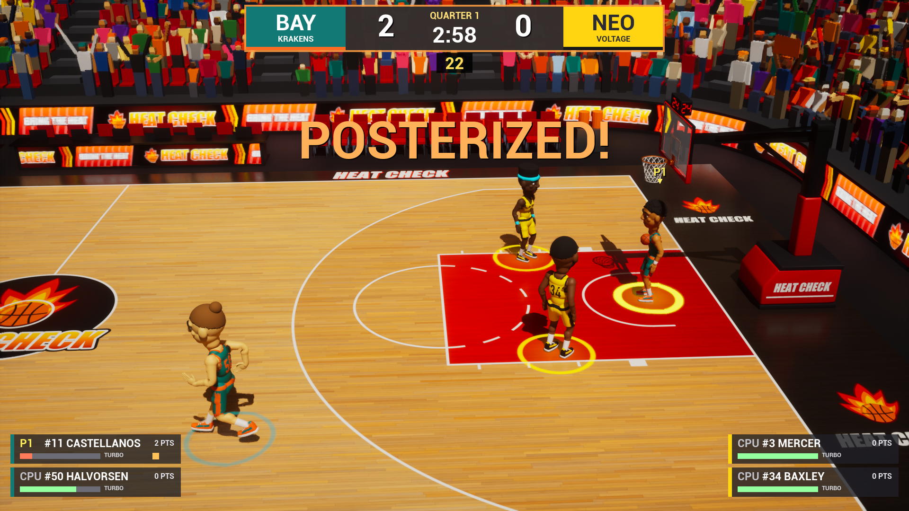
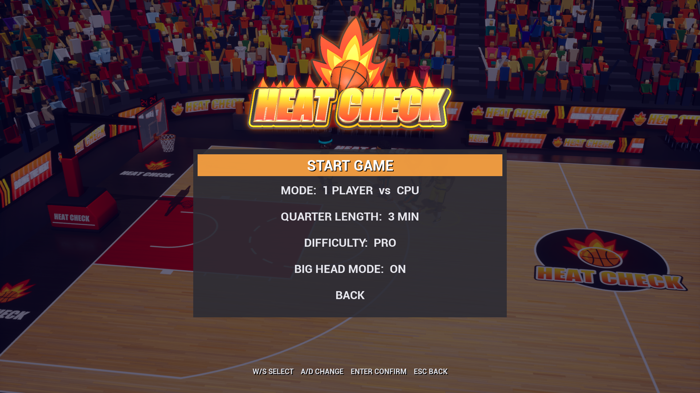
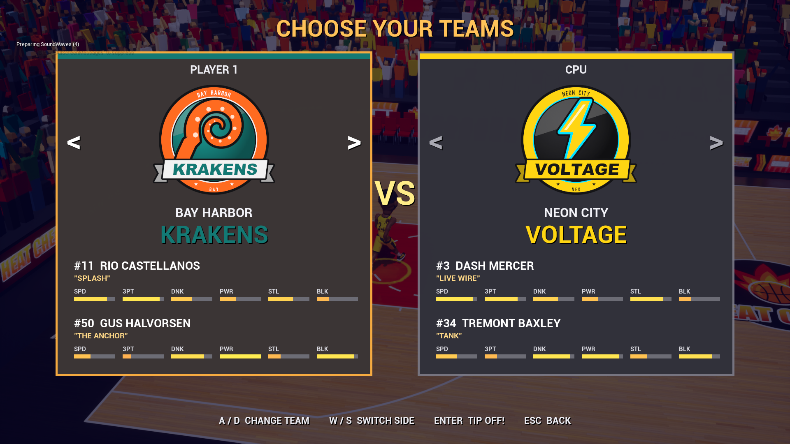
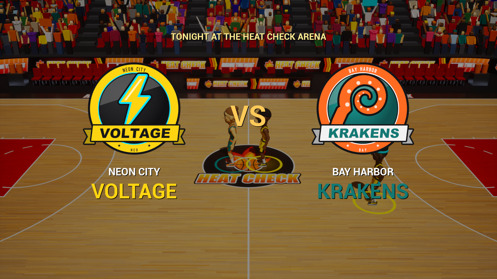

# HEAT CHECK — 2-on-2 Arcade Basketball

An original, over-the-top 2-on-2 arcade basketball game in the spirit of the classic 90s cabinets:
turbo sprints, 10-foot-high dunks, shoving with no fouls, and players who **heat up** and catch
**on fire**. Every 3D model, texture, animation and sound is generated procedurally. Blender (5.3)
builds all the art from Python scripts, and the game itself is C++ on Unreal Engine 5.9.



**[▶ Play it in your browser](https://nearbycoder.github.io/heatcheck/play/)** · [Website](https://nearbycoder.github.io/heatcheck/)


| Main menu | Team select | Tip-off intro |
|---|---|---|
|  |  |  |

## Play

```bash
Tools/play.sh               # windowed 1920x1080 (add -fullscreen for full screen)
Tools/play.sh -hcwatch      # jump straight into a CPU-vs-CPU game
```

[Watch the referee toss, tip and first shove in the packaged game.](Docs/media/tip-and-shove.mp4)

The title screen runs a CPU-vs-CPU **attract mode** behind the logo. Press **Enter** (or Start),
pick a mode and options, choose both teams and tip off.

A packaged standalone app (if you built one with `Tools/package.sh`) lives in `Build/Packaged/Mac`.

### Graphics and sound

Open **Graphics** or **Sound** from the main menu or pause menu. Move with the arrow keys, WASD or D-pad. Adjust with left and right, switch tabs with Tab or the shoulder buttons, and return with Esc or the right face button. Settings take effect immediately and save when you leave Options or quit.

- **Graphics** offers Performance, Balanced, High, Ultra and Cinematic presets. Fine-tune render scale, shadows, textures, anti-aliasing, reflections, effects, post-processing, shading and arena detail. Higher settings animate the upper deck, add crowd spotlights and enable overhead softbox shadows. Frame rate limit and VSync are independent of the preset. A fresh profile starts at Balanced, 80% render scale and a 120 FPS limit.
- **The quality meter** shows FPS and real frame time, averaged over half a second. The white tick marks the 8.33 ms budget for 120 FPS. The pause menu measures the paused scene. Turn on the in-game meter to check moving gameplay.
- **Sound** has separate levels for master, music, announcer, crowd, gameplay effects and menu sounds. Press Enter or the bottom face button to preview a channel. **Mute all** preserves the mix.
- **Quit Game** exits the application from either menu. **Q** exits from the title screen.

### Controls

| | Player 1 (keyboard) | Player 1 (gamepad) | Player 2 (keyboard) |
|---|---|---|---|
| Move | W A S D | Left stick / D-pad | Arrow keys |
| Shoot / jump / block | J (or Space): hold, release at the top of the jump | A | Numpad 1 or `,` |
| Pass / steal | K | X or B | Numpad 2 or `.` |
| Shove (off ball) | H | Y / Triangle | M or Numpad 0 |
| Turbo | L or Left Shift | RB / LB / RT | Numpad 3, `/` or Right Shift |
| Pause | Esc or P | Start | |

On defense, release turbo and move across or away from a nearby ball handler to shuffle or backpedal while facing them. Hold turbo to turn and chase. [Watch the movement in a packaged match](Docs/media/movement.mp4).

Combos:
- **Turbo + Shoot** inside dunk range = **dunk**. The style depends on distance: two-hand, windmill, 360, reverse, and a flip when you're on fire.
- **Shove** while facing a nearby opponent to push them back and jar the ball loose. You can also clear space when your teammate has the ball. **Turbo + Shove** adds a knockdown with enough stamina. **Turbo + Steal** still shoves on defense.
- **Turbo + Pass** to a teammate near the rim = **alley-oop**.
- When your CPU teammate has the ball, **Pass** calls for it and **Shoot** tells him to shoot.
- A timing meter appears next to your shooter. Release at the apex (the green zone) for the best percentage.

### Rules (how the arcade original played, re-created)

- **2-on-2**, four quarters (1–5 minutes each, 3 by default), **overtime** if tied.
- The referee tosses the **jump ball** to start the game and each overtime. Press **Shoot** after the release to tip it toward your teammate. Quarters 2 and 3 start with the tip loser inbounding, quarter 4 with the tip winner.
- **No fouls.** Shoving, elbowing and knocking people down is legal.
- Only two violations are called: the **24-second shot clock** and **goaltending** (blocking a shot on its way down counts the basket).
- **Heating up / On fire.** Make 2 baskets in a row without the other team scoring and you're *heating up* (+accuracy). Make 3 and you're **ON FIRE**:
  - unlimited turbo, much better shooting, more dunk range, and harder shoves and steals
  - the ball leaves a flame trail and the net burns when you score
  - you can goaltend without penalty
  - the fire goes out when the other team scores, or after 4 more baskets
- After a made basket the other team inbounds from under that basket. The clock stops during inbounds.
- 3-pointers count from beyond the arc or in the corners. Buzzer-beaters count.
- CPU catch-up: like the arcade original, the CPU finds a little extra when it falls far behind (depends on difficulty).

### Modes and options

- **1 Player vs CPU**: you plus a CPU teammate.
- **2 Players co-op**: both on the same team.
- **2 Players head-to-head**: each human gets a CPU teammate.
- **CPU vs CPU**: watch the AI play.
- **Difficulty**: Rookie, Pro or Legend.
- **Big head mode**: just what it sounds like.

Six original teams, each with two players:

| Team | Players |
|---|---|
| Neon City Voltage | Mercer, Baxley |
| Bay Harbor Krakens | Castellanos, Halvorsen |
| Red Rock Scorpions | Delacroix, Montalvo |
| Frostburg Yetis | Brekke, Arakawa |
| Steel Valley Forge | Kowalski, Whitfield |
| Sunset Coast Surge | Fontaine, Lindqvist |

Every player has ratings for speed, shooting, 3PT, dunk, pass, power, steal, block and clutch, and their own look.

## Web version

The browser build in [`web/play/`](web/play) is a Three.js port of the Unreal game. It runs on the
same Blender-generated models, animations and synthesized audio, and it ports the C++ gameplay
module by module: match flow, shot odds, heat and fire, the analytic ball physics, every action state,
the CPU AI, the broadcast camera and the HUD. It supports keyboard, gamepads (two players) and
on-screen touch controls, and offers graphics presets and per-channel volume.

[`web/`](web) is also the marketing site. GitHub Actions publishes it to GitHub Pages on every push to
`main` (`.github/workflows/pages.yml`).

```bash
Tools/web/build_web_assets.sh      # FBX/WAV exports -> web/play/assets (glTF + meshopt, MP3/Opus)
python3 -m http.server 8000        # then open http://localhost:8000/web/play/
```

The asset pipeline needs Blender 5.3, ffmpeg and Node 18+. Run `npm install` in `Tools/web`
first; `Tools/web/README.md` has the details. The game itself has no build step: three.js is vendored
in `web/play/vendor`.

URL options for testing: `?watch` (CPU vs CPU), `?quarter=1` (quarter length in minutes), `?speed=8`
(simulation speed), `?fps` (frame-time meter) and `?touch` (force touch controls).

## How it's built

```
Blender/*.py ──► Art/Export/{Meshes,Anims,Textures,UI,Audio} ──► Tools/ue_import.py ──► Content/HeatCheck
 (procedural       FBX + PNG + WAV + JSON material manifests      (UE Python: import,        + C++ gameplay
  models & anims)                                                  materials, map)            (Source/HeatCheck)
```

| Asset | Generator |
|---|---|
| Athlete body: one skinned mesh with V-neck jersey, trim, shorts, socks and high-top sneakers; stylized big head with face | `Blender/gen_character.py` |
| 7 hair styles, 2 beards, headband, wristbands, 30 jersey-number meshes, 6 team chest wordmarks (all modular skeletal meshes) | `Blender/gen_character.py` |
| 25-bone skeleton and IK pose builder | `Blender/char_rig.py` |
| 22 player clips, including defensive shuffles, backpedaling and dunk landings. Scrub the authored keys and contact markers in [the Blender action library](Art/Blend/player_actions.blend). | `Blender/gen_anims.py` |
| Striped official, two-handed referee toss and one-handed player tip in [the jump-ball Blender scene](Art/Blend/referee.blend) | `Blender/gen_referee.py` |
| Court (8K hardwood texture, keys, logos) | `Blender/gen_court.py` |
| Hoop (stanchion, glass, rim, net) | `Blender/gen_hoop.py` |
| Ball | `Blender/gen_ball.py` |
| Arena (bowl, 6,354 seats, 5,754 animated fans, LED ribbons, benches, scorer's table, jumbotron, light rig, banners) | `Blender/gen_arena.py` |
| 3D title logo, team badges, FX sprites | `Blender/gen_branding.py` |
| 82 sound effects, crowd beds, announcer lines and two music loops (numpy synthesis + macOS `say`) | `Tools/gen_audio.py` |

Gameplay is all C++ (`Source/HeatCheck`). There are no Blueprints or Anim Blueprints:

| Class | What it does |
|---|---|
| `AHCGameMode` | Match flow (tip-off, inbounds, quarters, OT), clocks, scoring, heat/fire, menus |
| `HCGameModeEvents.cpp` | Shot odds, dunks, alley-oops, steals, shoves, blocks and goaltending |
| `HCAI.cpp` | CPU brains: shot selection by rating and intent (drive, pull-up, spot-up three), passing, alley-oops, matchup and help defense, steals, shoves, block and rebound timing |
| `AHCCharacter` | Movement, turbo, every action state, dunk flights with spin and flip variants, knockdowns, team-colored materials, fire glow |
| `UHCAnimInstance` | Native animation player that crossfades the Blender clips (and drives big-head mode) |
| `AHCBall` | Analytic ball physics (torus rim, backboard, floor, net drag), scripted makes and misses, synced dribbling, homing passes, fire trail |
| `AHCHoop` | Rim shake, net swish, flaming net |
| `AHCArena` | Loads the arena meshes, lighting rig, crowd excitement (material parameter collection) |
| `UHCSpriteFX` | Instanced-mesh particle system for flames and sparks |
| `AHCCameraDirector` | Broadcast sideline camera with dunk zoom and shake |
| `AHCHUD` | Scoreboard, meters, call-outs, menus and box scores (Canvas) |
| `UHCAudio` | Sound effects, announcer queue, music, crowd bed |

## Rebuilding everything

```bash
Tools/build_art.sh          # Blender + audio generators   (chars | env | audio to do one part)
Tools/import_assets.sh      # import into Unreal, build materials + map
Tools/build.sh              # compile the C++ module
Tools/play.sh
Tools/package.sh            # optional: standalone HeatCheck.app
```

Requirements: macOS with Xcode, Blender 5.3 (`blender` on PATH), and the Unreal Engine 5.9 source
build at `~/UnrealEngine` (override with `UE_ROOT=`). `Docs/ASSET_SPEC.md` documents the
Blender→Unreal conventions (units, pivots, material manifest format).

### Testing hooks

- `blender -b Art/Blend/player_actions.blend --python-exit-code 1 -P Blender/check_motion.py` samples every frame to check loop seams, floor contact, event markers and the fall-to-get-up transition.

- `Tools/simulate.sh [quarter-minutes]` plays a full CPU game headless at maximum speed and prints the box score and key events (fire, stuffs, goaltending, shot-clock violations).
- `Tools/simulate.sh 2 -hcautopilot` makes Player 1 play through the real human input path: menus, held-button jump shots, turbo dunks, steals and shoves.
- `Tools/play.sh -autoshot -autoshotint=5 -autoshotdur=60` saves screenshots to `Saved/AutoShots`.

### Measuring 120 FPS

Run the packaged Development build with the display set to 120 Hz or ProMotion.

```bash
python3 Tools/benchmark.py                    # 1080p window, CPU vs CPU
python3 Tools/benchmark.py --player --match
```

The short test samples 3,600 frames and drops the first 600 for warm-up. The full-match test measures every frame from tip-off to the final buzzer with one-minute quarters, including stoppages and overtime. Both use real elapsed frame times, rendered graphics and sound. The report prints the Unreal CSV path, average FPS, p50/p95/p99 and the percentage of frames delivered within 8.33 ms. Compare the same presentation mode under similar system load. macOS synchronizes windowed Metal presentation to the display even when VSync is disabled in-game.

On the 40-core GPU M5 Max at 1920×1080, the final short comparison measured 100.2 FPS on the original package and 119.8 FPS on the optimized package. Median GPU time fell from 8.29 ms to 5.20 ms. A separate four-quarter one-player autopilot run with other Unreal sessions active averaged 52.2 FPS across 22,339 frames, with a 49.16 ms p95. With the referee and shoves enabled, a four-quarter one-player run on the same machine averaged 90.0 FPS across 34,873 frames with another game instance active. The 95th-percentile frame time was 16.11 ms, and 12.6% of frames met the 8.33 ms budget. Sustained full-match 120 FPS remains open.

## Notes

- Everything here is original: names, teams, logos, announcer lines and art. The game borrows the *genre* and its classic rules, not anyone's IP.
- The engine at `~/UnrealEngine` is shared with another local project. To stop two projects from invalidating each other's compiled modules, `Engine/Build/Build.version` was given a fixed `"BuildId": "local-shared-dev"`. If you ever see *"The game module 'HeatCheck' could not be found"*, run `Tools/build.sh`.
